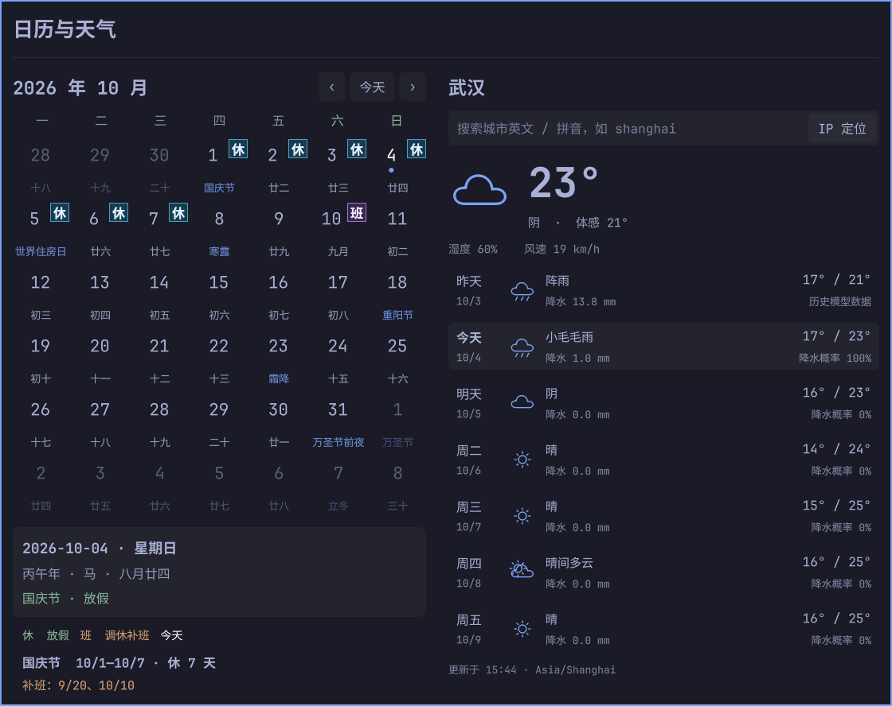

# Omarchy Days · 日历与天气

原生 Omarchy / Quickshell 插件。启用后在任务栏的托盘区域显示日历图标，点击打开左侧日历、右侧天气的面板。兼容水平、垂直状态栏以及 `andy.side-panel`，跟随 Omarchy 主题。



## 功能

- 公历月历、中国农历、闰月、传统节日与节气；切换月份，点击查看某一天。
- 中国大陆官方放假与调休补班标记；展示完整假期和跨月补班日期。
- 默认按公网 IP 定位城市；可用中文、英文、拼音或拼音前缀搜索手动切换。
- 搜索支持大小写、空格和别名，例如 `shang`、`shang hai`、`Beijing`、`Peking`、`xi'an`。
- 本地提供 2,336 个城市／城镇索引，优先离线搜索；其他地点使用在线搜索。
- 候选项显示省份／地区，区分同名和同拼音城市。
- 天气来源可选 Open-Meteo（原有服务）或和风天气。Open-Meteo 展示昨天、今天和未来五天，和风天气展示从今天开始的七日预报；显示天气、最低／最高温、降水量、降水概率和今日体感、湿度、风速。
- 手动选择保存在 `shell.json` 的插件条目中，重启后保留，可切回 IP 定位。
- 异步请求、搜索防抖、15 分钟天气缓存、断网提示与旧缓存回退。

## 安装

需要支持插件的 Omarchy Shell、Quickshell、Python 3.10+ 和网络（首次安装依赖、天气与 IP 定位）。和风天气 JWT 签名还需要 OpenSSL 3+。

克隆项目并安装：

```bash
git clone https://github.com/manateelazycat/omarchy-days.git
cd omarchy-days
bash install.sh
```

安装脚本将插件复制到 `${XDG_CONFIG_HOME:-~/.config}/omarchy/plugins/andy.days/`，把农历依赖安装到 `${XDG_DATA_HOME:-~/.local/share}/omarchy-days/venv/`，等待 Shell 完成扫描后启用图标。已有托盘组件时，将日历图标放在其旁边；在 `andy.side-panel` 中显示于左侧侧栏，隐藏时移动鼠标到屏幕左边缘展开。重复运行可更新本地安装；不会覆盖 Git 管理的安装目录。依赖环境放在插件目录外，符合 Omarchy 禁止插件内部符号链接的规则。

如果通过 `omarchy plugin add https://github.com/manateelazycat/omarchy-days --yes` 安装，请在安装目录中先运行 `bash bootstrap.sh`，再运行 `omarchy plugin enable andy.days --section right`。Omarchy 的 Git 安装器不会执行插件的安装脚本。

搭配 `andy.side-panel` 时，请使用支持保留插件自身弹窗样式的侧栏版本；旧版的统一弹窗样式会覆盖日历字号、字色和角标形状。日历通过 `preservePopupAppearance` 声明保留自身样式。

```bash
omarchy plugin disable andy.days
omarchy plugin remove andy.days --yes
```

卸载插件不会删除共享依赖环境和天气缓存，需要时可自行清理。

## 操作

- 点击状态栏日历图标：打开／关闭面板；点击面板外或按 `Esc` 关闭。
- `‹` / `›` 或左右方向键：切换月份；“今天”或 `Home` 返回今天。
- 按 `/` 聚焦城市搜索；直接输入英文／拼音，或用 `Ctrl+V` / `Shift+Insert` 粘贴中文等城市名称；输入至少两个字符；上下键选候选项，`Enter` 确认。
- 搜索框聚焦时使用原生编辑，支持中文输入法；未聚焦时保持只读，减少后台剪贴板探测。主动粘贴需要 `wl-paste`（`wl-clipboard` 包），在独立进程中最多读取 4 KiB，超时 1 秒；搜索文本最多 120 字符。中键不粘贴。
- 清空搜索或搜索框内按 `Esc` 返回天气；“IP 定位”恢复自动定位。
- 图标中键强制更新天气。

也可以从终端调用：

```bash
omarchy-shell andy.days toggle
omarchy-shell andy.days refresh
```

天气栏底部的“天气配置”可切换数据来源，配置视图在天气栏内打开，返回后继续查看天气：

1. 默认使用 Open-Meteo，无需凭据。
2. 选择“和风天气”，填写 API Host、开发者 ID（iss）、项目 ID（sub）、凭据 ID（kid）和 Ed25519 私钥的本机绝对路径；对应公钥需提前上传到和风天气控制台。参考[官方 JWT 认证文档](https://dev.qweather.com/docs/configuration/authentication/)。
3. 点击“测试连接”，验证北京实时天气与七日预报的访问权限；成功后点击“保存并使用”。修改参数后需重新测试。保存时会再次验证，失败不会覆盖原配置；取消也不会切换来源。
4. 随时可选回 Open-Meteo 并保存，不需要删除和风天气凭据。

天气来源配置保存到 `${XDG_CONFIG_HOME:-~/.config}/omarchy-days/weather.json`，文件权限为 `600`。只保存参数与私钥路径，不保存私钥内容或 JWT；JWT 在每次请求时短期签发。开发时可将本机密钥和参数放在 `data/qweather/`，该目录整体被 Git 忽略，也不会被安装脚本复制到插件目录。请自行保管密钥；重新安装后仍应指向已有私钥文件。

天气围绕所选城市的当地“今天”展示，翻阅日历不会改变天气日期范围。中国大陆使用北京时间，其他城市使用地点时区。

## 数据与限制

农历和节气由 [lunar-python](https://github.com/6tail/lunar-python) 本地计算，日历可离线使用，界面支持 1901–2099 年。

放假调休数据来自 [holiday-cn](https://github.com/NateScarlet/holiday-cn)，其中记录了国务院公告原文链接。附带 2024–2026 年快照；浏览其他年份时会尝试下载对应数据，每天最多检查一次。未收录年份明确提示，农历节日不会自动冒充官方放假。假期数据仅用于中国大陆。

默认天气来自 [Open-Meteo](https://open-meteo.com/en/docs)。昨天使用该接口的近期历史模型数据，当前天气同样基于天气模型，并非气象站实测值。温度单位为摄氏度，风速为 km/h；缺失数据用 `—` 显示。免费公开接口适用于非商业使用；商业用途请遵守服务条款或换用商业接口。

选择和风天气时使用其 v1 实时天气和每日预报接口，采用相同的城市坐标与时区。该来源不展示昨天的历史数据。数据使用须遵守[和风天气归因要求](https://developer.qweather.com/attribution.html)及服务条款。

城市索引由 [GeoNames](https://www.geonames.org/) `cities15000` 数据筛选生成（中国大陆、香港、澳门、台湾），是有规模的城市和城镇集合，不能保证覆盖所有乡镇。索引未匹配时由 [Open-Meteo Geocoding](https://open-meteo.com/en/docs/geocoding-api) 在线补充全球地点。IP 定位优先使用 [myip.ipip.net](https://myip.ipip.net/)，返回的中文地点通过本地城市索引解析为坐标；定位失败或显示为海外时，改用 [myip.la](https://www.myip.la/) 复核，境外城市由其坐标加上 Open-Meteo 时区补全。自动定位可能受代理和 VPN 影响。手动模式不调用 IP 定位服务。

天气、搜索、IP 及年度假期缓存保存在 `${XDG_CACHE_HOME:-~/.cache}/omarchy-days/`。切换城市时清除旧面板数据，网络失败不会显示其他城市的天气。旧天气缓存最多回退 48 小时；Open-Meteo 缓存日期跨天时重新按当前日期排列，缺少的日期显示 `—`。和风天气缓存按来源、凭据和城市隔离，只回退同一天的天气。

## 开发与验证

```bash
bash bootstrap.sh
python3 -m unittest discover -s tests -v
# 输入与剪贴板回归检查需要 Qt 6 开发文件、Qt Test、g++ 和 pkg-config
python3 scripts/check_input.py
omarchy plugin validate .
python3 backend.py month --year 2026 --month 10
python3 backend.py search --query 'shang hai' --offline
```

使用 `python3 scripts/update_data.py` 从上游重新生成离线城市索引和节假日快照。插件入口是 `BarWidget.qml`，布局在 `DaysPanel.qml`，异步进程管理在 `DaysModel.qml`，数据处理在 `backend.py`。

`bash scripts/preview.sh` 可在独立 Quickshell 实例中预览，不修改现有状态栏配置。按 `Ctrl+C` 退出。预览自带模拟的状态栏设置接口，城市选择只保存在该实例中。

## 许可与署名

Copyright (C) 2026 Andy Stewart。

项目代码使用 **GNU General Public License v3.0（GPL-3.0-only）**，完整协议见 [LICENSE](LICENSE)。

节假日数据保留上游 MIT 许可，见 [licenses/holiday-cn-MIT.txt](licenses/holiday-cn-MIT.txt)。修改后的 GeoNames 城市索引按 [CC BY 4.0](https://creativecommons.org/licenses/by/4.0/) 使用并署名 GeoNames，见 [licenses/geonames-notice.txt](licenses/geonames-notice.txt)；天气数据署名 Open-Meteo。农历依赖使用上游 MIT 许可。

### 和风精细预报与刷新

选择和风天气且接口均可用时，天气区显示 24 小时分时预报，以及未来约两小时、每 5 分钟一格的降水预报。降水提示和柱状图仅在当前有雨雪或未来两小时预计有雨雪时显示。雨雪开始和结束时间均为预测；分钟降水接口有区域覆盖限制。实时、七日、小时或分钟数据不可用时自动回退 Open-Meteo，下次更新重试和风，不改动保存的来源配置。

和风无雨雪每 10 分钟刷新，有雨雪每 5 分钟刷新。天气面板关闭后仍按此周期更新；锁屏、全部屏幕进入 DPMS 待机、系统休眠时停止天气请求，解锁或恢复可用后立即刷新。唤醒后若仍锁屏，等成功解锁再请求。系统状态通过本地 Omarchy IPC、Hyprland 与 login1 监听，约一秒内响应；读取不到系统状态时暂停请求。多屏请求通过文件锁合并。

新增运行依赖是 Omarchy 自带的 `dbus-monitor` 和 `hyprctl`。私钥只在本地用于 JWT 签名，`data/qweather/` 不参与 Git 或插件安装复制。

和风来源下，搜索框调用 GeoAPI 城市搜索和 POI 搜索（景点、潮汐站）。结果显示地点名称及所在城市；选择后保存 POI 经纬度、名称、城市和时区，用该坐标获取天气。和风当前不提供通用住宅小区搜索，未收录的小区名无法通过此接口查询。其他来源继续使用原有城市搜索。

### 天气预警

和风来源下按当前位置的经纬度独立查询官方天气预警，每 15 分钟刷新，关闭面板仍保持调度。锁屏、显示器待机或休眠时暂停并取消进行中的请求；恢复可用后立即强制刷新，若唤醒后仍锁屏则等待解锁。天气数据临时回退 Open-Meteo 不影响和风预警查询。

预警入口位于当前天气右侧，显示和风官方图标及预警类别，点击展开发布机构、正文和防御指南。无预警时隐藏；过期、取消和被新版本替代的预警移除。请求失败时保留尚未过期的上次预警并标记更新失败，不把失败当作没有预警。数据来源及接口要求的归因说明随预警显示。

预警图标使用 [QWeather Icons v1.8.0](https://icons.qweather.com/)，图标采用 CC BY 4.0，代码采用 MIT；原始字体和署名保存在 `assets/qweather/`，许可见 `licenses/qweather-icons.txt`。

### 天气系统通知

天气配置中的“天气通知”开关默认开启，修改后保存生效，单独修改开关不需要测试连接。和风天气启用后，分钟预报出现未来两小时雨雪将至、将停，以及官方预警发布、更新、取消时，通过 Omarchy 系统通知提示。通知使用和风图标，点击打开天气面板；严重预警使用系统重要通知。

通知按地点持久去重，多屏和 Shell 重启不重复提醒；降水时间调整达到 15 分钟时再次提示。锁屏、休眠、屏幕待机时暂停，恢复后根据重新获取的数据判断。失败或回退数据不产生提醒，预警过期或从列表消失不等同于官方取消。去重状态保存在 `~/.local/state/omarchy-days/notifications.json`。

天气配置支持自定义位置：启用后填写名称和十进制经纬度，保存时验证经度 ±180、纬度 ±90 的范围。和风天气、分钟预报与预警优先使用此坐标，面板隐藏搜索和 IP 定位入口；关闭后恢复原有定位。自定义位置的时间按本机时区显示，接口按其支持的精度查询。
